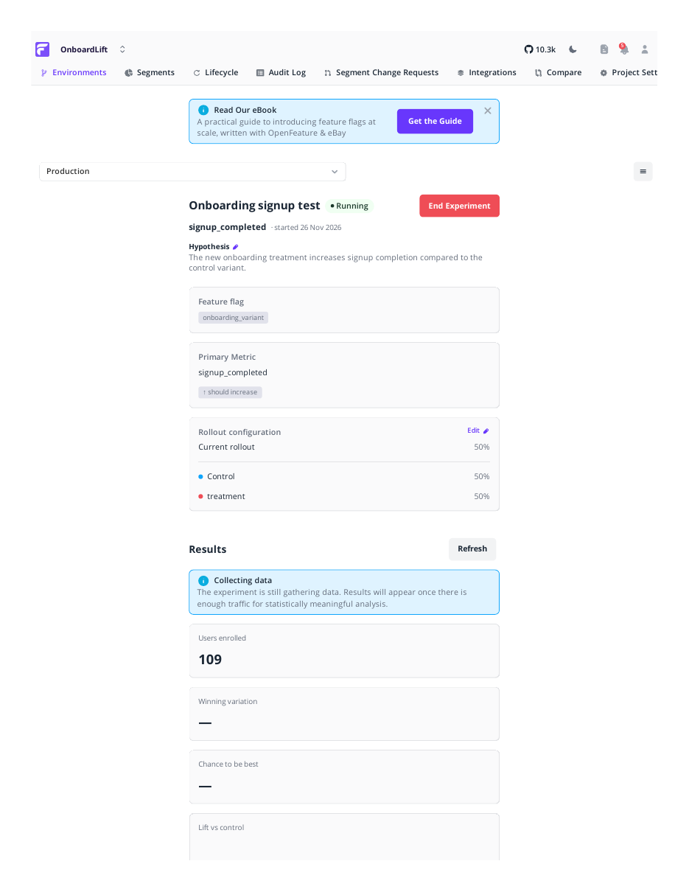

# OnboardLift

A tiny task tracker for solo founders, built for **Toggle Wars, the Flagsmith Experimentation Hackathon** (WeMakeDevs x Flagsmith, 26 to 29 Nov 2026), **Track 01: Test Something Real** ($2,000 cash).

Live demo: coming soon (GitHub Pages link will go here once the Flagsmith project is connected).

## The hypothesis

New users who see a short 3 field signup and a dashboard prefilled with sample data complete signup and take a first action more often than users who see a 6 field signup and an empty dashboard.

Long signup forms and empty first screens kill first session activation. This experiment tests both frictions at once, because that is the real first run experience: the form, then the first screen.

## The two versions

One multivariate flag decides everything the visitor sees after the landing page.

| | Version A: control | Version B: treatment |
| --- | --- | --- |
| Signup form | 6 fields: name, email, company, team size, role, password | 3 fields: name, email, password |
| Dashboard | Empty state, "Create your first task" prompt | 3 sample tasks already there, ready to tick off |

Both versions share the same landing page, the same styling, and the same app code. Only the flag value differs.

## Flagsmith wiring

- **Flag:** `onboarding_variant`, multivariate, values `control` and `treatment`.
- **Traffic split:** 50 / 50 through a Flagsmith Experiment.
- **Experiment:** "Onboarding signup test", hypothesis as stated above.
- **Primary metric:** `signup_completed`, fired once when the signup form is submitted.
- **Secondary metric:** `first_action_clicked`, fired the first time a signed up visitor creates a task or completes one.
- **Identity:** a stable UUID per visitor, stored in `localStorage` on first visit and reused on every later visit. A visitor never flips between versions. The app reads the variant with `getExperimentFlag`, which also records the exposure, and sends events with `trackEvent`.
- **Keys:** only the client side environment key is used, passed through the `VITE_FLAGSMITH_ENVIRONMENT_KEY` environment variable. No server side key is committed to this repo. See `.env.example`.

## Simulated traffic

Track 01 explicitly allows simulated traffic, and four days is too short for real users to fill an experiment. `simulate.mjs` runs sessions through real SDK evaluation with distinct stable identifiers, never by hardcoding the variant.

Behaviour model (documented, not real user data):

| | Control | Treatment |
| --- | --- | --- |
| Signup rate | 0.32 | 0.55 |
| First action rate, given signup | 0.35 | 0.60 |

The model says the shorter form converts better because there is less to fill in, and sample tasks invite a first click because the value is visible in the first five seconds. The rates are assumptions to test, not claims about real users.

Run in batches so the experiment graph shows traffic over time, not a single spike:

```bash
node simulate.mjs --sessions 200 --batch 1   # 27 Nov
node simulate.mjs --sessions 200 --batch 2   # 28 Nov
```

Total: 400 sessions, about 200 per variant.

## Setup

Requirements: Node.js 20 or later.

```bash
git clone https://github.com/dunoil/onboardlift.git
cd onboardlift
npm install
cp .env.example .env
# Put the Flagsmith Cloud client side environment key in .env:
# VITE_FLAGSMITH_ENVIRONMENT_KEY=<key from project OnboardLift, Production environment>
npm run dev      # local development server
npm run build    # production build into dist/
npm run preview  # serve the production build locally
```

## What success looks like

1. The app loads, shows the landing page, and the footer names the version the visitor sees.
2. Reloading keeps the same visitor in the same version (stable identifier).
3. Submitting signup fires `signup_completed`; creating or completing a first task fires `first_action_clicked`.
4. After the simulator runs, the Flagsmith experiment dashboard shows exposures and conversions for both versions, with a win probability per version.
5. On 29 Nov the winner is rolled out to 100 percent with the same flag, and the app is reloaded live to prove it.

## Experiment result

Batch 1 ran 27 Nov 2026 (200 sessions, experiment rollout 50 percent). Flagsmith dashboard after a manual Results Refresh: 109 users enrolled, control 45 exposures with 15 `signup_completed` conversions (33.3 percent), treatment 64 exposures with 25 conversions (39.1 percent). Win probability not shown yet, the dashboard reads "Collecting data". Batch 2 (200 sessions) runs 28 Nov, then the win probability is read on 29 Nov.



Note: the simulator exposed 136 control sessions, but the dashboard counts only the 45 enrolled ones. At 50 percent rollout the other 91 control sessions were unenrolled identities falling back to the flag default, so they recorded no exposure and their events are not attributed to the experiment. Treatment matches exactly (64 exposed, 25 signups) because every treatment assignment is enrolled.

## Limits, stated honestly

- The traffic is simulated with assumed conversion rates, so the result tests the pipeline and the experiment design, not real user behaviour.
- With 400 sessions the win probability is indicative, not conclusive. More traffic would be needed to raise confidence, and the demo video says so.
- The app has no auth, no database, and no backend. Signup state lives in the browser only, which is enough for the experiment and nothing more.

## Demo video

Link will be added here on 29 Nov 2026. Outline: the problem (0:00 to 0:15), the app in both versions with a stable visitor staying in one version on reload (0:15 to 1:30), the Flagsmith flag, metric, split, and win probability (1:30 to 2:15), the winner rolled to 100 percent live with the same flag (2:15 to 2:45).

## Status

- 26 Nov 2026: app scaffolded and both versions built. Flagsmith Cloud setup complete and verified: project OnboardLift (ID 56417), multivariate flag `onboarding_variant` (control / treatment, 50/50), metric `signup_completed`, experiment "Onboarding signup test" (ID 523). Client side environment key is in `.env` and the SDK reads the live flag. Experiment rollout is 0 percent until the 27 Nov run raises it.
- 27 Nov 2026: raise the experiment rollout to 50 percent, run simulator batch 1 (200 sessions), screenshot the experiment dashboard.
- 28 Nov 2026: simulator batch 2 (200 sessions) only, no new features.
- 29 Nov 2026: read the win probability, roll the winner to 100 percent, finish this README, record the demo video, submit before 22:30 WITA.

## Submission

Per Rule 08 of the hackathon: this public repo, this README, and the demo video. The WeMakeDevs page hosts registration only and has no project submission form, so the final submission channel is confirmed with the organizers (Flagsmith Discord) before 29 Nov.
